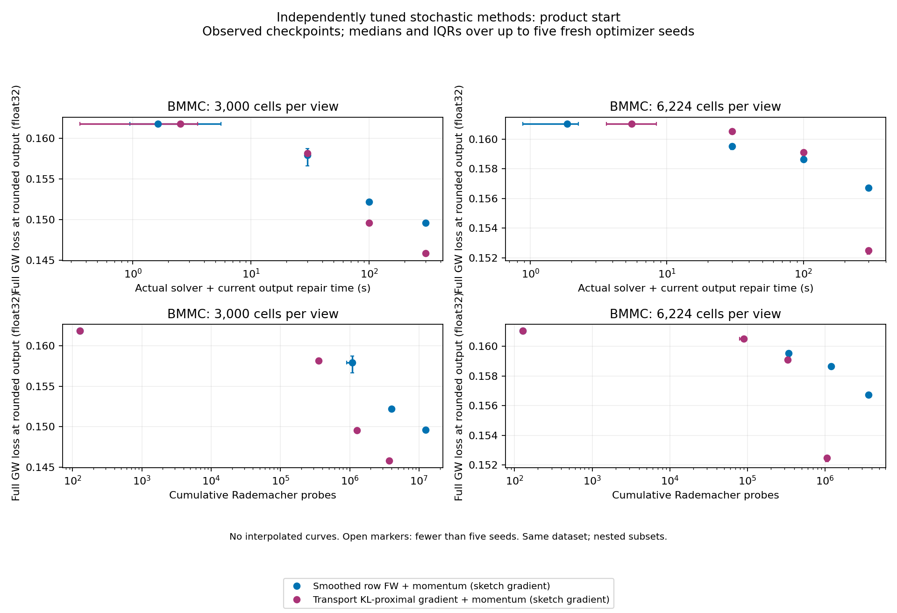
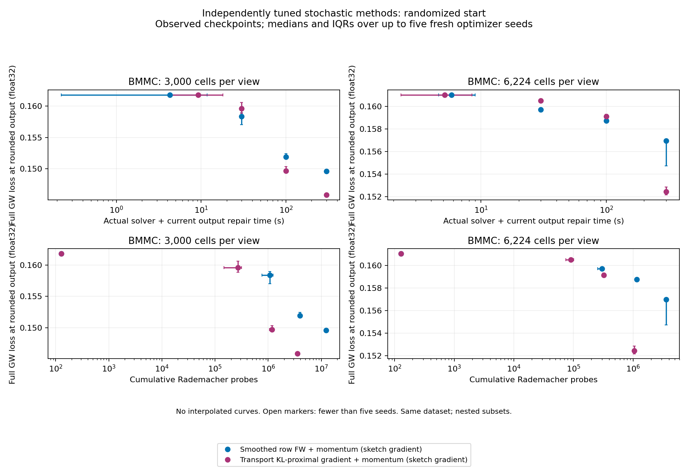

# BMMC scaling campaign

Expected **40 final runs in 20 paired tasks**. Valid outputs: **40**; scientific failures: **0**; missing runs: **0**; infrastructure/provenance failures: **0**.

Execution is complete.

Compare **Smoothed row FW + momentum (sketch gradient)** with **Transport KL-proximal gradient + momentum (sketch gradient)**. Each final pair shares its instance, starting plan, stochastic seed, q=128 estimator, momentum schedule and GPU allocation. Both receive a 300-second solver budget.

## Parameter selection

Independently tune each method and size with 12 candidates, three development seeds and both starts at60s; select once before fresh final seeds200-204. Sharedq128/rho0=.3. This supersedes the frozen runner momentum_config.parameter_policy describing Stage C inheritance.

The authoritative policy is this campaign configuration and frozen selection. Legacy `momentum_config.parameter_policy` text in the frozen runner describing inherited Stage C settings is superseded; it is retained in JSON for provenance.

Selection rule: Per(size,method), minimum median final float64 rounded loss over all six development(start,seed) cells; any invalid output disqualifies candidate; exact-score ties by candidate ID; no fallback if all ineligible.

Selection provenance: validated

| Cells/view | Method | Selected candidate | Parameters |
|---:|---|---|---|
| 3000 | Smoothed row FW + momentum (sketch gradient) | c10 | {"gamma0": 1.0, "mu_scale": 10.0} |
| 3000 | Transport KL-proximal gradient + momentum (sketch gradient) | c00 | {"eta": 0.1, "eta_power": 0.0, "inner_tol": 0.0001} |
| 6224 | Smoothed row FW + momentum (sketch gradient) | c10 | {"gamma0": 1.0, "mu_scale": 10.0} |
| 6224 | Transport KL-proximal gradient + momentum (sketch gradient) | c00 | {"eta": 0.1, "eta_power": 0.0, "inner_tol": 0.0001} |

## Final saved outputs

Entries are median [Q1, Q3] with observed/prescribed seed counts; IQR uses linear quantiles. Only validated final outputs contribute. The float64 losses evaluate the saved rounded couplings, without optimizing or re-rounding them.

| Cells/view | Start | Method | Float64 rounded GW loss | Actual solver seconds | Solver + final repair seconds | Recorded process seconds |
|---:|---|---|---:|---:|---:|---:|
| 3000 | product | Smoothed row FW + momentum (sketch gradient) | 0.149619 [0.149413, 0.149696] (5/5) | 300.002 [300.001, 300.003] (5/5) | 300.003 [300.002, 300.004] (5/5) | 311.347 [309.841, 313.025] (5/5) |
| 3000 | product | Transport KL-proximal gradient + momentum (sketch gradient) | 0.145843 [0.145734, 0.145863] (5/5) | 300.004 [300.003, 300.006] (5/5) | 300.006 [300.004, 300.008] (5/5) | 334.061 [318.462, 335.599] (5/5) |
| 3000 | randomized | Smoothed row FW + momentum (sketch gradient) | 0.149589 [0.149418, 0.149845] (5/5) | 300 [300, 300.002] (5/5) | 300.002 [300.002, 300.003] (5/5) | 315.08 [304.718, 347.697] (5/5) |
| 3000 | randomized | Transport KL-proximal gradient + momentum (sketch gradient) | 0.145859 [0.14584, 0.146018] (5/5) | 300.01 [300.009, 300.012] (5/5) | 300.011 [300.01, 300.013] (5/5) | 332.814 [324.732, 346.682] (5/5) |
| 6224 | product | Smoothed row FW + momentum (sketch gradient) | 0.156729 [0.156606, 0.156826] (5/5) | 300.003 [300.001, 300.003] (5/5) | 300.008 [300.006, 300.008] (5/5) | 349.855 [337.225, 392.538] (5/5) |
| 6224 | product | Transport KL-proximal gradient + momentum (sketch gradient) | 0.152488 [0.152238, 0.152508] (5/5) | 300.02 [300.009, 300.028] (5/5) | 300.025 [300.014, 300.033] (5/5) | 417.072 [383.47, 436.438] (5/5) |
| 6224 | randomized | Smoothed row FW + momentum (sketch gradient) | 0.156968 [0.154744, 0.156972] (5/5) | 300.007 [300.004, 300.007] (5/5) | 300.012 [300.009, 300.012] (5/5) | 384.583 [367.022, 411.445] (5/5) |
| 6224 | randomized | Transport KL-proximal gradient + momentum (sketch gradient) | 0.152442 [0.152172, 0.152856] (5/5) | 300.023 [300.023, 300.027] (5/5) | 300.028 [300.027, 300.032] (5/5) | 391.18 [330.784, 396.518] (5/5) |

| Cells/view | Start | Method | Outer updates | Probes | Raw marginal L1 residual | Inner stopping failures | Peak allocated GPU bytes |
|---:|---|---|---:|---:|---:|---:|---:|
| 3000 | product | Smoothed row FW + momentum (sketch gradient) | 96721 [94538, 97211] (5/5) | 1.23803e+07 [1.21009e+07, 1.2443e+07] (5/5) | 0.0342392 [0.0338202, 0.0346717] (5/5) | 0 [0, 0] (5/5) | 8.98381e+08 [8.98381e+08, 8.98381e+08] (5/5) |
| 3000 | product | Transport KL-proximal gradient + momentum (sketch gradient) | 28814 [28439, 29023] (5/5) | 3.68819e+06 [3.64019e+06, 3.71494e+06] (5/5) | 8.99611e-05 [8.41383e-05, 9.72866e-05] (5/5) | 0 [0, 0] (5/5) | 9.34382e+08 [9.34382e+08, 9.34382e+08] (5/5) |
| 3000 | randomized | Smoothed row FW + momentum (sketch gradient) | 96491 [94081, 97785] (5/5) | 1.23508e+07 [1.20424e+07, 1.25165e+07] (5/5) | 0.0345827 [0.0340688, 0.0352934] (5/5) | 0 [0, 0] (5/5) | 8.98381e+08 [8.98381e+08, 8.98381e+08] (5/5) |
| 3000 | randomized | Transport KL-proximal gradient + momentum (sketch gradient) | 27914 [27728, 28378] (5/5) | 3.57299e+06 [3.54918e+06, 3.63238e+06] (5/5) | 8.38125e-05 [8.32092e-05, 9.44863e-05] (5/5) | 0 [0, 0] (5/5) | 9.34382e+08 [9.34382e+08, 9.34382e+08] (5/5) |
| 6224 | product | Smoothed row FW + momentum (sketch gradient) | 28317 [28182, 28345] (5/5) | 3.62458e+06 [3.6073e+06, 3.62816e+06] (5/5) | 0.252863 [0.250081, 0.254208] (5/5) | 0 [0, 0] (5/5) | 3.75835e+09 [3.75835e+09, 3.75835e+09] (5/5) |
| 6224 | product | Transport KL-proximal gradient + momentum (sketch gradient) | 8233 [8188, 8301] (5/5) | 1.05382e+06 [1.04806e+06, 1.06253e+06] (5/5) | 3.48506e-05 [3.39129e-05, 3.57909e-05] (5/5) | 10 [9, 16] (5/5) | 3.91354e+09 [3.9133e+09, 3.91354e+09] (5/5) |
| 6224 | randomized | Smoothed row FW + momentum (sketch gradient) | 28022 [27694, 28105] (5/5) | 3.58682e+06 [3.54483e+06, 3.59744e+06] (5/5) | 0.253717 [0.219462, 0.256062] (5/5) | 0 [0, 0] (5/5) | 3.75835e+09 [3.75835e+09, 3.75835e+09] (5/5) |
| 6224 | randomized | Transport KL-proximal gradient + momentum (sketch gradient) | 8177 [8116, 8356] (5/5) | 1.04666e+06 [1.03885e+06, 1.06957e+06] (5/5) | 3.58831e-05 [3.10885e-05, 3.8689e-05] (5/5) | 9 [6, 10] (5/5) | 3.9133e+09 [3.9133e+09, 3.9133e+09] (5/5) |

Detailed timing components, CPU peak RSS, GPU reserved memory, raw row/column residuals, inner iteration counts, seed identities, environments and all recorded trace rows are retained in [report.json](report.json). Launcher process time includes interpreter startup and the final metadata write; the runner-only timing components have narrower scopes. Memory peaks include preparation and float64 validation.

## Coverage and failures

| Task | Size/start/seed | Status | Detail |
|---:|---|---|---|
| 0 | 3000/product/200 | completed | 2 valid; 0 scientific failures |
| 1 | 3000/product/201 | completed | 2 valid; 0 scientific failures |
| 2 | 3000/product/202 | completed | 2 valid; 0 scientific failures |
| 3 | 3000/product/203 | completed | 2 valid; 0 scientific failures |
| 4 | 3000/product/204 | completed | 2 valid; 0 scientific failures |
| 5 | 3000/randomized/200 | completed | 2 valid; 0 scientific failures |
| 6 | 3000/randomized/201 | completed | 2 valid; 0 scientific failures |
| 7 | 3000/randomized/202 | completed | 2 valid; 0 scientific failures |
| 8 | 3000/randomized/203 | completed | 2 valid; 0 scientific failures |
| 9 | 3000/randomized/204 | completed | 2 valid; 0 scientific failures |
| 10 | 6224/product/200 | completed | 2 valid; 0 scientific failures |
| 11 | 6224/product/201 | completed | 2 valid; 0 scientific failures |
| 12 | 6224/product/202 | completed | 2 valid; 0 scientific failures |
| 13 | 6224/product/203 | completed | 2 valid; 0 scientific failures |
| 14 | 6224/product/204 | completed | 2 valid; 0 scientific failures |
| 15 | 6224/randomized/200 | completed | 2 valid; 0 scientific failures |
| 16 | 6224/randomized/201 | completed | 2 valid; 0 scientific failures |
| 17 | 6224/randomized/202 | completed | 2 valid; 0 scientific failures |
| 18 | 6224/randomized/203 | completed | 2 valid; 0 scientific failures |
| 19 | 6224/randomized/204 | completed | 2 valid; 0 scientific failures |

## Recorded checkpoints

Markers are actual checkpoint observations aggregated by prescribed checkpoint, with medians and IQRs of the recorded coordinates. They are not interpolated to a common time or probe budget. Open markers indicate incomplete five-seed coverage. Traces from rejected final outputs remain in JSON but are excluded from these figures. Final float64 endpoint loss appears in the tables; checkpoint plots use the full float32 loss logged by the solver.

- [product_quality.pdf](product_quality.pdf)

- [randomized_quality.pdf](randomized_quality.pdf)

## Interpretation limits

- One BMMC dataset: optimizer seeds are repetitions, not independent biological datasets.
- The two cell subsets are nested and costs are separately normalized by size; raw loss levels cannot establish improvement across sizes.
- Each method and size is independently tuned on the prescribed limited grid with equal development budgets; this does not establish globally optimal hyperparameters.
- Equal solver-time budgets are not equal gradient-call or probe budgets. The work plots show actual observations without interpolation or a fixed-work claim.
- Checkpoint losses are full, unsampled float32 objective evaluations. Final endpoint losses are separate float64 evaluations of the saved rounded outputs.
- Solver plus current output repair time excludes preparation, prior diagnostics and serialization. End-to-end recorded process time includes these costs and is reported separately.
- Inner stopping failures remain visible even when the final rounded output passes validation.
- Missing and infrastructure-failed runs are excluded from numerical aggregates and never replaced by zero or treated as successful runs.

## Provenance

The JSON binds the campaign configuration, controller, report source, frozen selection, per-task receipts/manifests/shard records, metadata, traces and failure records by SHA-256. Recorded runner source hashes, instance/array hashes and initial-plan hashes are preserved. Numerical outputs and original records are not modified.

Runtime commit: `b5851980646be55a148b083a89cfbf6153dac77e`. Selection SHA-256: `5c957787ff4fa7fcdf9c1b5ac77fc83fa566ad8b3211652809be5f7b961eaa71`.
