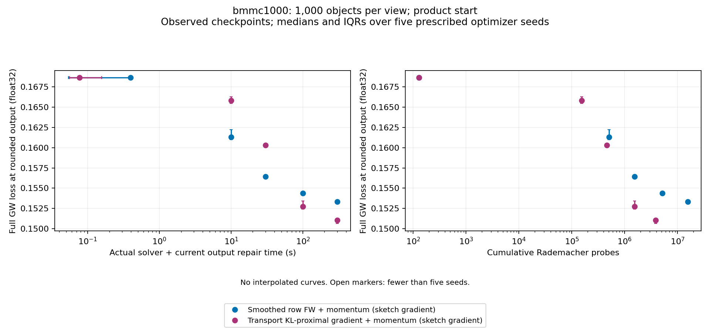
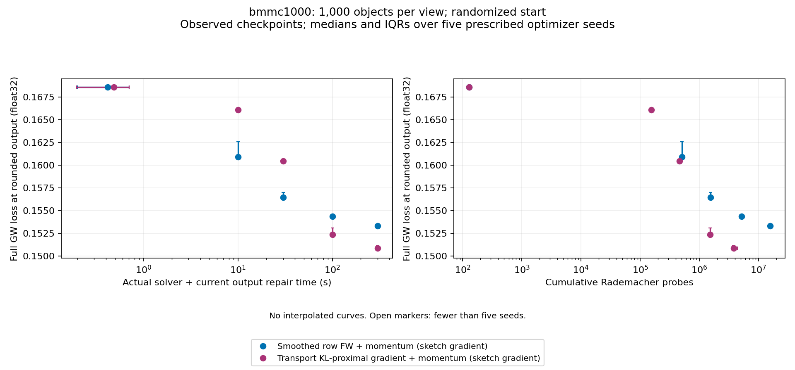
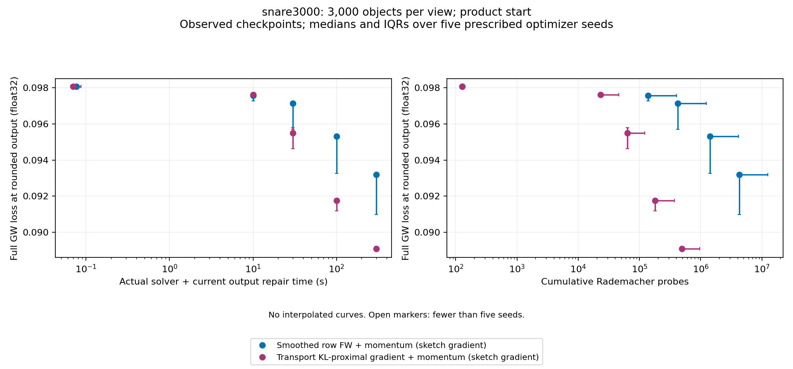
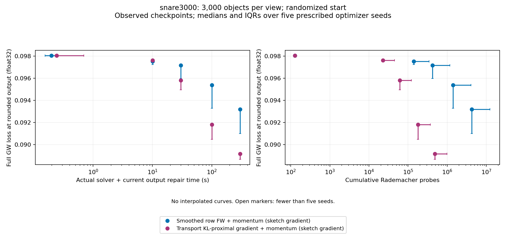
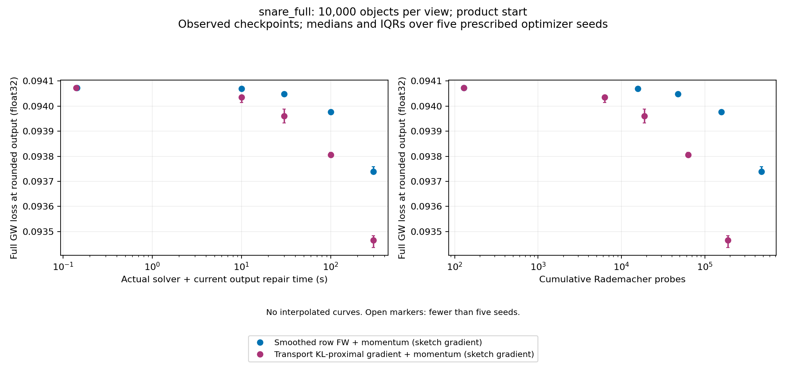
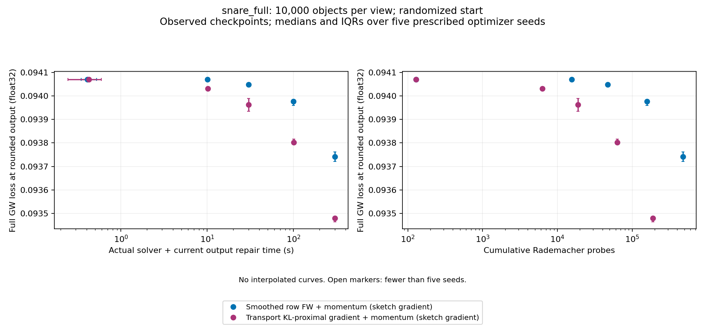

# Cross-dataset stochastic GW campaign

Expected **60 final runs in 30 paired tasks**. Valid outputs: **60**; scientific failures: **0**; missing runs: **0**; infrastructure/provenance failures: **0**.

Execution is complete.

Compare **Smoothed row FW + momentum (sketch gradient)** with **Transport KL-proximal gradient + momentum (sketch gradient)**. Each final pair shares its instance, starting plan, stochastic seed, q=128 estimator, momentum schedule and GPU allocation. Both receive a 300-second solver budget.

## Parameter selection

Independently tune each method and instance with 12 candidates, three development seeds and both starts at 60s; select once before fresh final seeds 300-304. Shared q128/rho0=.3. This supersedes the frozen runner momentum_config.parameter_policy describing Stage C inheritance.

The authoritative policy is this campaign configuration and frozen selection. Legacy `momentum_config.parameter_policy` text in the frozen runner describing inherited Stage C settings is superseded; it is retained in JSON for provenance.

Selection rule: Per(instance,method), minimum median final float64 rounded loss over all six development(start,seed) cells; any invalid output disqualifies candidate; exact-score ties by candidate ID; no fallback if all ineligible.

Selection provenance: validated

| Instance | Method | Selected candidate | Parameters |
|---:|---|---|---|
| bmmc1000 | Smoothed row FW + momentum (sketch gradient) | c10 | {"gamma0": 1.0, "mu_scale": 10.0} |
| bmmc1000 | Transport KL-proximal gradient + momentum (sketch gradient) | c00 | {"eta": 0.1, "eta_power": 0.0, "inner_tol": 0.0001} |
| snare3000 | Smoothed row FW + momentum (sketch gradient) | c10 | {"gamma0": 1.0, "mu_scale": 10.0} |
| snare3000 | Transport KL-proximal gradient + momentum (sketch gradient) | c02 | {"eta": 1.0, "eta_power": 0.0, "inner_tol": 0.0001} |
| snare_full | Smoothed row FW + momentum (sketch gradient) | c00 | {"gamma0": 0.1, "mu_scale": 0.1} |
| snare_full | Transport KL-proximal gradient + momentum (sketch gradient) | c00 | {"eta": 0.1, "eta_power": 0.0, "inner_tol": 0.0001} |

## Final saved outputs

Entries are median [Q1, Q3] with observed/prescribed seed counts; IQR uses linear quantiles. Only validated final outputs contribute. The float64 losses evaluate the saved rounded couplings, without optimizing or re-rounding them.

| Instance | Start | Method | Float64 rounded GW loss | Actual solver seconds | Solver + final repair seconds | Recorded process seconds |
|---:|---|---|---:|---:|---:|---:|
| bmmc1000 | product | Smoothed row FW + momentum (sketch gradient) | 0.153347 [0.153327, 0.153388] (5/5) | 300.001 [300.001, 300.001] (5/5) | 300.002 [300.002, 300.002] (5/5) | 305.724 [303.556, 305.817] (5/5) |
| bmmc1000 | product | Transport KL-proximal gradient + momentum (sketch gradient) | 0.151063 [0.150625, 0.151165] (5/5) | 300.004 [300.001, 300.006] (5/5) | 300.005 [300.002, 300.007] (5/5) | 303.445 [303.371, 303.686] (5/5) |
| bmmc1000 | randomized | Smoothed row FW + momentum (sketch gradient) | 0.153311 [0.153287, 0.153361] (5/5) | 300.001 [300, 300.001] (5/5) | 300.002 [300.001, 300.003] (5/5) | 304.343 [304.226, 306.083] (5/5) |
| bmmc1000 | randomized | Transport KL-proximal gradient + momentum (sketch gradient) | 0.150872 [0.150652, 0.151126] (5/5) | 300.005 [300.004, 300.012] (5/5) | 300.006 [300.006, 300.013] (5/5) | 303.63 [303.468, 305.623] (5/5) |
| snare3000 | product | Smoothed row FW + momentum (sketch gradient) | 0.0931866 [0.0909699, 0.0931996] (5/5) | 300.003 [300.001, 300.005] (5/5) | 300.007 [300.003, 300.009] (5/5) | 305.404 [305.355, 305.464] (5/5) |
| snare3000 | product | Transport KL-proximal gradient + momentum (sketch gradient) | 0.0890686 [0.0890441, 0.0892065] (5/5) | 300.028 [300.028, 300.044] (5/5) | 300.032 [300.03, 300.047] (5/5) | 304.88 [304.543, 305.113] (5/5) |
| snare3000 | randomized | Smoothed row FW + momentum (sketch gradient) | 0.0931826 [0.0909994, 0.0932085] (5/5) | 300.003 [300.001, 300.005] (5/5) | 300.005 [300.004, 300.008] (5/5) | 304.302 [304.031, 304.649] (5/5) |
| snare3000 | randomized | Transport KL-proximal gradient + momentum (sketch gradient) | 0.0891537 [0.0886498, 0.0891716] (5/5) | 300.012 [300.01, 300.052] (5/5) | 300.015 [300.012, 300.055] (5/5) | 304.177 [304.169, 305.152] (5/5) |
| snare_full | product | Smoothed row FW + momentum (sketch gradient) | 0.0937384 [0.0937336, 0.0937593] (5/5) | 300.06 [300.023, 300.061] (5/5) | 300.086 [300.049, 300.086] (5/5) | 331.597 [331.547, 331.78] (5/5) |
| snare_full | product | Transport KL-proximal gradient + momentum (sketch gradient) | 0.0934649 [0.0934368, 0.0934837] (5/5) | 300.084 [300.049, 300.164] (5/5) | 300.11 [300.075, 300.189] (5/5) | 327.501 [326.948, 327.55] (5/5) |
| snare_full | randomized | Smoothed row FW + momentum (sketch gradient) | 0.0937417 [0.093721, 0.093761] (5/5) | 300.059 [300.016, 300.071] (5/5) | 300.085 [300.042, 300.097] (5/5) | 332.527 [331.409, 333.034] (5/5) |
| snare_full | randomized | Transport KL-proximal gradient + momentum (sketch gradient) | 0.093479 [0.0934643, 0.0934873] (5/5) | 300.04 [300.029, 300.121] (5/5) | 300.066 [300.04, 300.146] (5/5) | 326.586 [326.439, 326.986] (5/5) |

| Instance | Start | Method | Outer updates | Probes | Raw marginal L1 residual | Inner stopping failures | Peak allocated GPU bytes |
|---:|---|---|---:|---:|---:|---:|---:|
| bmmc1000 | product | Smoothed row FW + momentum (sketch gradient) | 121484 [121283, 121752] (5/5) | 1.555e+07 [1.55242e+07, 1.55843e+07] (5/5) | 0.0198473 [0.0192849, 0.0200911] (5/5) | 0 [0, 0] (5/5) | 1.30569e+08 [1.30569e+08, 1.3154e+08] (5/5) |
| bmmc1000 | product | Transport KL-proximal gradient + momentum (sketch gradient) | 30180 [29956, 32013] (5/5) | 3.86304e+06 [3.83437e+06, 4.09766e+06] (5/5) | 8.93116e-05 [8.69301e-05, 9.06869e-05] (5/5) | 0 [0, 1] (5/5) | 1.34569e+08 [1.34568e+08, 1.35539e+08] (5/5) |
| bmmc1000 | randomized | Smoothed row FW + momentum (sketch gradient) | 121869 [121386, 121992] (5/5) | 1.55992e+07 [1.55374e+07, 1.5615e+07] (5/5) | 0.0199706 [0.0194461, 0.0200607] (5/5) | 0 [0, 0] (5/5) | 1.31538e+08 [1.30569e+08, 1.31538e+08] (5/5) |
| bmmc1000 | randomized | Transport KL-proximal gradient + momentum (sketch gradient) | 29961 [29629, 34575] (5/5) | 3.83501e+06 [3.79251e+06, 4.4256e+06] (5/5) | 9.74228e-05 [8.76843e-05, 9.83528e-05] (5/5) | 0 [0, 0] (5/5) | 1.34569e+08 [1.34568e+08, 1.35539e+08] (5/5) |
| snare3000 | product | Smoothed row FW + momentum (sketch gradient) | 33159 [33089, 97497] (5/5) | 4.24435e+06 [4.23539e+06, 1.24796e+07] (5/5) | 0.099311 [0.0375694, 0.100085] (5/5) | 0 [0, 0] (5/5) | 8.98429e+08 [8.98429e+08, 8.98429e+08] (5/5) |
| snare3000 | product | Transport KL-proximal gradient + momentum (sketch gradient) | 3846 [3786, 7463] (5/5) | 492288 [484608, 955264] (5/5) | 8.66072e-05 [8.42078e-05, 9.01749e-05] (5/5) | 2 [0, 11] (5/5) | 9.3443e+08 [9.3443e+08, 9.3443e+08] (5/5) |
| snare3000 | randomized | Smoothed row FW + momentum (sketch gradient) | 33142 [33099, 97083] (5/5) | 4.24218e+06 [4.23667e+06, 1.24266e+07] (5/5) | 0.0974155 [0.0376602, 0.101529] (5/5) | 0 [0, 0] (5/5) | 8.98429e+08 [8.98429e+08, 8.98429e+08] (5/5) |
| snare3000 | randomized | Transport KL-proximal gradient + momentum (sketch gradient) | 3790 [3782, 7705] (5/5) | 485120 [484096, 986240] (5/5) | 9.74162e-05 [8.74946e-05, 9.81153e-05] (5/5) | 1 [0, 12] (5/5) | 9.3443e+08 [9.3443e+08, 9.3443e+08] (5/5) |
| snare_full | product | Smoothed row FW + momentum (sketch gradient) | 3714 [3714, 3715] (5/5) | 475392 [475392, 475520] (5/5) | 1.06534 [1.06494, 1.0711] (5/5) | 0 [0, 0] (5/5) | 9.63857e+09 [9.63857e+09, 9.63857e+09] (5/5) |
| snare_full | product | Transport KL-proximal gradient + momentum (sketch gradient) | 1472 [1472, 1473] (5/5) | 188416 [188416, 188544] (5/5) | 6.26904e-05 [6.03812e-05, 6.36825e-05] (5/5) | 0 [0, 0] (5/5) | 1.00391e+10 [1.00386e+10, 1.00391e+10] (5/5) |
| snare_full | randomized | Smoothed row FW + momentum (sketch gradient) | 3710 [3694, 3712] (5/5) | 474880 [472832, 475136] (5/5) | 1.07472 [1.05798, 1.07512] (5/5) | 0 [0, 0] (5/5) | 9.63857e+09 [9.63857e+09, 9.63857e+09] (5/5) |
| snare_full | randomized | Transport KL-proximal gradient + momentum (sketch gradient) | 1472 [1471, 1472] (5/5) | 188416 [188288, 188416] (5/5) | 6.07511e-05 [5.88075e-05, 6.46988e-05] (5/5) | 0 [0, 0] (5/5) | 1.00386e+10 [1.00386e+10, 1.00386e+10] (5/5) |

## Known correspondence diagnostics

These values evaluate the final recorded rounded output using labels withheld from optimization and tuning. Top-1 accuracy is higher-is-better; normalized true-match rank is lower-is-better; true-pair transported mass is higher-is-better. BMMC has no label file and is not applicable.

| Instance | Start | Method | Top-1 accuracy | Normalized true-match rank | True-pair mass |
|---|---|---|---:|---:|---:|
| bmmc1000 | product | Smoothed row FW + momentum (sketch gradient) | Not applicable | Not applicable | Not applicable |
| bmmc1000 | product | Transport KL-proximal gradient + momentum (sketch gradient) | Not applicable | Not applicable | Not applicable |
| bmmc1000 | randomized | Smoothed row FW + momentum (sketch gradient) | Not applicable | Not applicable | Not applicable |
| bmmc1000 | randomized | Transport KL-proximal gradient + momentum (sketch gradient) | Not applicable | Not applicable | Not applicable |
| snare3000 | product | Smoothed row FW + momentum (sketch gradient) | 0.000333333 [0.000333333, 0.0005] (5/5) | 0.553934 [0.53858, 0.555303] (5/5) | 0.000278526 [0.000277115, 0.000311872] (5/5) |
| snare3000 | product | Transport KL-proximal gradient + momentum (sketch gradient) | 0 [0, 0] (5/5) | 0.505984 [0.496657, 0.508927] (5/5) | 0.000236447 [0.000128426, 0.000356512] (5/5) |
| snare3000 | randomized | Smoothed row FW + momentum (sketch gradient) | 0.000222222 [0.000166667, 0.000666667] (5/5) | 0.550782 [0.536915, 0.554355] (5/5) | 0.000277362 [0.000275561, 0.00031059] (5/5) |
| snare3000 | randomized | Transport KL-proximal gradient + momentum (sketch gradient) | 0.000166667 [0, 0.000333333] (5/5) | 0.500219 [0.499457, 0.504535] (5/5) | 0.000348557 [0.000191124, 0.000557934] (5/5) |
| snare_full | product | Smoothed row FW + momentum (sketch gradient) | 1.85835e-05 [1.46869e-05, 0.000118159] (5/5) | 0.511446 [0.508733, 0.51212] (5/5) | 9.77105e-05 [9.68529e-05, 9.81427e-05] (5/5) |
| snare_full | product | Transport KL-proximal gradient + momentum (sketch gradient) | 5e-05 [5e-05, 5e-05] (5/5) | 0.517542 [0.511633, 0.519315] (5/5) | 9.26381e-05 [9.25665e-05, 9.52128e-05] (5/5) |
| snare_full | randomized | Smoothed row FW + momentum (sketch gradient) | 0 [0, 0.0001] (5/5) | 0.511098 [0.509029, 0.512235] (5/5) | 9.7131e-05 [9.69294e-05, 9.74886e-05] (5/5) |
| snare_full | randomized | Transport KL-proximal gradient + momentum (sketch gradient) | 0 [0, 0.0001] (5/5) | 0.514497 [0.513836, 0.518822] (5/5) | 8.59991e-05 [8.5684e-05, 9.84994e-05] (5/5) |

## First observed attainment of common loss targets

Thresholds are 99%, 97%, 95% and 90% of the pilot product initial loss, fixed before development tuning. Times below include actual solver time plus current output repair. Initial-iterate attainment retains its measured time. No interpolation is used. The JSON preserves the preceding observed point; nonmonotone loss means these observations do not establish a true first-passage interval.

Time statistics are conditional on attainment and must be read with the attained and censored counts. A run with no recorded attainment is censored at its last usable observation; missing or invalid runs are unavailable, not censored successes.

| Instance | Start | Method | Target fraction | Threshold | Attained / 5 | Censored / 5 | Time among attained (s) |
|---|---|---|---:|---:|---:|---:|---:|
| bmmc1000 | product | Smoothed row FW + momentum (sketch gradient) | 0.99 | 0.166936 | 5 | 0 | 10.0025 [10.0025, 10.0031] (5/5) |
| bmmc1000 | product | Smoothed row FW + momentum (sketch gradient) | 0.97 | 0.163563 | 5 | 0 | 10.0025 [10.0025, 10.0031] (5/5) |
| bmmc1000 | product | Smoothed row FW + momentum (sketch gradient) | 0.95 | 0.160191 | 5 | 0 | 30.002 [30.0017, 30.0023] (5/5) |
| bmmc1000 | product | Smoothed row FW + momentum (sketch gradient) | 0.9 | 0.15176 | 0 | 5 | — (0/5) |
| bmmc1000 | product | Transport KL-proximal gradient + momentum (sketch gradient) | 0.99 | 0.166936 | 5 | 0 | 10.0045 [10.0038, 10.0052] (5/5) |
| bmmc1000 | product | Transport KL-proximal gradient + momentum (sketch gradient) | 0.97 | 0.163563 | 5 | 0 | 30.0026 [30.002, 30.0036] (5/5) |
| bmmc1000 | product | Transport KL-proximal gradient + momentum (sketch gradient) | 0.95 | 0.160191 | 5 | 0 | 100.007 [100.001, 100.007] (5/5) |
| bmmc1000 | product | Transport KL-proximal gradient + momentum (sketch gradient) | 0.9 | 0.15176 | 4 | 1 | 300.006 [300.004, 300.009] (4/5) |
| bmmc1000 | randomized | Smoothed row FW + momentum (sketch gradient) | 0.99 | 0.166936 | 5 | 0 | 10.0026 [10.0021, 10.0032] (5/5) |
| bmmc1000 | randomized | Smoothed row FW + momentum (sketch gradient) | 0.97 | 0.163563 | 5 | 0 | 10.0026 [10.0021, 10.0032] (5/5) |
| bmmc1000 | randomized | Smoothed row FW + momentum (sketch gradient) | 0.95 | 0.160191 | 5 | 0 | 30.0021 [30.0021, 30.0032] (5/5) |
| bmmc1000 | randomized | Smoothed row FW + momentum (sketch gradient) | 0.9 | 0.15176 | 0 | 5 | — (0/5) |
| bmmc1000 | randomized | Transport KL-proximal gradient + momentum (sketch gradient) | 0.99 | 0.166936 | 5 | 0 | 10.0073 [10.005, 10.0074] (5/5) |
| bmmc1000 | randomized | Transport KL-proximal gradient + momentum (sketch gradient) | 0.97 | 0.163563 | 5 | 0 | 30.0031 [30.0028, 30.0075] (5/5) |
| bmmc1000 | randomized | Transport KL-proximal gradient + momentum (sketch gradient) | 0.95 | 0.160191 | 5 | 0 | 100.004 [100.002, 100.007] (5/5) |
| bmmc1000 | randomized | Transport KL-proximal gradient + momentum (sketch gradient) | 0.9 | 0.15176 | 4 | 1 | 300.009 [300.005, 300.013] (4/5) |
| snare3000 | product | Smoothed row FW + momentum (sketch gradient) | 0.99 | 0.0970877 | 5 | 0 | 100.003 [30.0045, 100.008] (5/5) |
| snare3000 | product | Smoothed row FW + momentum (sketch gradient) | 0.97 | 0.0951263 | 5 | 0 | 300.007 [100.002, 300.009] (5/5) |
| snare3000 | product | Smoothed row FW + momentum (sketch gradient) | 0.95 | 0.0931649 | 2 | 3 | 300.002 [300.002, 300.003] (2/5) |
| snare3000 | product | Smoothed row FW + momentum (sketch gradient) | 0.9 | 0.0882615 | 0 | 5 | — (0/5) |
| snare3000 | product | Transport KL-proximal gradient + momentum (sketch gradient) | 0.99 | 0.0970877 | 5 | 0 | 30.016 [30.0132, 30.035] (5/5) |
| snare3000 | product | Transport KL-proximal gradient + momentum (sketch gradient) | 0.97 | 0.0951263 | 5 | 0 | 100.019 [30.035, 100.057] (5/5) |
| snare3000 | product | Transport KL-proximal gradient + momentum (sketch gradient) | 0.95 | 0.0931649 | 5 | 0 | 100.019 [100.006, 100.057] (5/5) |
| snare3000 | product | Transport KL-proximal gradient + momentum (sketch gradient) | 0.9 | 0.0882615 | 1 | 4 | 300.03 [300.03, 300.03] (1/5) |
| snare3000 | randomized | Smoothed row FW + momentum (sketch gradient) | 0.99 | 0.0970877 | 5 | 0 | 100.004 [30.0037, 100.005] (5/5) |
| snare3000 | randomized | Smoothed row FW + momentum (sketch gradient) | 0.97 | 0.0951263 | 5 | 0 | 300.005 [100.003, 300.008] (5/5) |
| snare3000 | randomized | Smoothed row FW + momentum (sketch gradient) | 0.95 | 0.0931649 | 2 | 3 | 300.004 [300.003, 300.004] (2/5) |
| snare3000 | randomized | Smoothed row FW + momentum (sketch gradient) | 0.9 | 0.0882615 | 0 | 5 | — (0/5) |
| snare3000 | randomized | Transport KL-proximal gradient + momentum (sketch gradient) | 0.99 | 0.0970877 | 5 | 0 | 30.0265 [30.0182, 30.0484] (5/5) |
| snare3000 | randomized | Transport KL-proximal gradient + momentum (sketch gradient) | 0.97 | 0.0951263 | 5 | 0 | 100.029 [30.0265, 100.03] (5/5) |
| snare3000 | randomized | Transport KL-proximal gradient + momentum (sketch gradient) | 0.95 | 0.0931649 | 5 | 0 | 100.029 [100.008, 100.03] (5/5) |
| snare3000 | randomized | Transport KL-proximal gradient + momentum (sketch gradient) | 0.9 | 0.0882615 | 1 | 4 | 300.007 [300.007, 300.007] (1/5) |
| snare_full | product | Smoothed row FW + momentum (sketch gradient) | 0.99 | 0.0931316 | 0 | 5 | — (0/5) |
| snare_full | product | Smoothed row FW + momentum (sketch gradient) | 0.97 | 0.0912502 | 0 | 5 | — (0/5) |
| snare_full | product | Smoothed row FW + momentum (sketch gradient) | 0.95 | 0.0893687 | 0 | 5 | — (0/5) |
| snare_full | product | Smoothed row FW + momentum (sketch gradient) | 0.9 | 0.0846651 | 0 | 5 | — (0/5) |
| snare_full | product | Transport KL-proximal gradient + momentum (sketch gradient) | 0.99 | 0.0931316 | 1 | 4 | 300.048 [300.048, 300.048] (1/5) |
| snare_full | product | Transport KL-proximal gradient + momentum (sketch gradient) | 0.97 | 0.0912502 | 0 | 5 | — (0/5) |
| snare_full | product | Transport KL-proximal gradient + momentum (sketch gradient) | 0.95 | 0.0893687 | 0 | 5 | — (0/5) |
| snare_full | product | Transport KL-proximal gradient + momentum (sketch gradient) | 0.9 | 0.0846651 | 0 | 5 | — (0/5) |
| snare_full | randomized | Smoothed row FW + momentum (sketch gradient) | 0.99 | 0.0931316 | 0 | 5 | — (0/5) |
| snare_full | randomized | Smoothed row FW + momentum (sketch gradient) | 0.97 | 0.0912502 | 0 | 5 | — (0/5) |
| snare_full | randomized | Smoothed row FW + momentum (sketch gradient) | 0.95 | 0.0893687 | 0 | 5 | — (0/5) |
| snare_full | randomized | Smoothed row FW + momentum (sketch gradient) | 0.9 | 0.0846651 | 0 | 5 | — (0/5) |
| snare_full | randomized | Transport KL-proximal gradient + momentum (sketch gradient) | 0.99 | 0.0931316 | 1 | 4 | 300.04 [300.04, 300.04] (1/5) |
| snare_full | randomized | Transport KL-proximal gradient + momentum (sketch gradient) | 0.97 | 0.0912502 | 0 | 5 | — (0/5) |
| snare_full | randomized | Transport KL-proximal gradient + momentum (sketch gradient) | 0.95 | 0.0893687 | 0 | 5 | — (0/5) |
| snare_full | randomized | Transport KL-proximal gradient + momentum (sketch gradient) | 0.9 | 0.0846651 | 0 | 5 | — (0/5) |

## Separate component profiling

These fixed-update companions use product initialization and seed 400, discard 20 warmup updates, and measure 200 updates with extra synchronization. They describe gradient and update-subroutine costs; their throughput is not used for the primary wall-time comparison.

| Instance | Method | Status | Gradient kernel (s) | Probe generation (s) | Row FW update (s) | Transport KL projection (s) | Other update work (s) |
|---|---|---|---:|---:|---:|---:|---:|
| bmmc1000 | Smoothed row FW + momentum (sketch gradient) | validated | 0.266897 | 0.02399 | 0.119727 | 0 | 0.170244 |
| bmmc1000 | Transport KL-proximal gradient + momentum (sketch gradient) | validated | 0.250799 | 0.019008 | 0 | 1.28652 | 0.092177 |
| snare3000 | Smoothed row FW + momentum (sketch gradient) | validated | 1.21856 | 0.0268923 | 0.154288 | 0 | 0.432539 |
| snare3000 | Transport KL-proximal gradient + momentum (sketch gradient) | validated | 1.2227 | 0.027289 | 0 | 10.1712 | 0.283438 |
| snare_full | Smoothed row FW + momentum (sketch gradient) | validated | 11.9448 | 0.0542749 | 0.568556 | 0 | 3.62421 |
| snare_full | Transport KL-proximal gradient + momentum (sketch gradient) | validated | 11.9278 | 0.0542696 | 0 | 25.5728 | 2.39776 |

Detailed timing components, CPU peak RSS, GPU reserved memory, raw row/column residuals, inner iteration counts, seed identities, environments and all recorded trace rows are retained in [report.json](report.json). Launcher process time includes interpreter startup and the final metadata write; the runner-only timing components have narrower scopes. Memory peaks include preparation and float64 validation.

## Coverage and failures

| Task | Instance/start/seed | Status | Detail |
|---:|---|---|---|
| 0 | bmmc1000/product/300 | completed | 2 valid; 0 scientific failures |
| 1 | bmmc1000/product/301 | completed | 2 valid; 0 scientific failures |
| 2 | bmmc1000/product/302 | completed | 2 valid; 0 scientific failures |
| 3 | bmmc1000/product/303 | completed | 2 valid; 0 scientific failures |
| 4 | bmmc1000/product/304 | completed | 2 valid; 0 scientific failures |
| 5 | bmmc1000/randomized/300 | completed | 2 valid; 0 scientific failures |
| 6 | bmmc1000/randomized/301 | completed | 2 valid; 0 scientific failures |
| 7 | bmmc1000/randomized/302 | completed | 2 valid; 0 scientific failures |
| 8 | bmmc1000/randomized/303 | completed | 2 valid; 0 scientific failures |
| 9 | bmmc1000/randomized/304 | completed | 2 valid; 0 scientific failures |
| 10 | snare3000/product/300 | completed | 2 valid; 0 scientific failures |
| 11 | snare3000/product/301 | completed | 2 valid; 0 scientific failures |
| 12 | snare3000/product/302 | completed | 2 valid; 0 scientific failures |
| 13 | snare3000/product/303 | completed | 2 valid; 0 scientific failures |
| 14 | snare3000/product/304 | completed | 2 valid; 0 scientific failures |
| 15 | snare3000/randomized/300 | completed | 2 valid; 0 scientific failures |
| 16 | snare3000/randomized/301 | completed | 2 valid; 0 scientific failures |
| 17 | snare3000/randomized/302 | completed | 2 valid; 0 scientific failures |
| 18 | snare3000/randomized/303 | completed | 2 valid; 0 scientific failures |
| 19 | snare3000/randomized/304 | completed | 2 valid; 0 scientific failures |
| 20 | snare_full/product/300 | completed | 2 valid; 0 scientific failures |
| 21 | snare_full/product/301 | completed | 2 valid; 0 scientific failures |
| 22 | snare_full/product/302 | completed | 2 valid; 0 scientific failures |
| 23 | snare_full/product/303 | completed | 2 valid; 0 scientific failures |
| 24 | snare_full/product/304 | completed | 2 valid; 0 scientific failures |
| 25 | snare_full/randomized/300 | completed | 2 valid; 0 scientific failures |
| 26 | snare_full/randomized/301 | completed | 2 valid; 0 scientific failures |
| 27 | snare_full/randomized/302 | completed | 2 valid; 0 scientific failures |
| 28 | snare_full/randomized/303 | completed | 2 valid; 0 scientific failures |
| 29 | snare_full/randomized/304 | completed | 2 valid; 0 scientific failures |

## Recorded checkpoints

Markers are actual checkpoint observations aggregated by prescribed checkpoint, with medians and IQRs of the recorded coordinates. They are not interpolated to a common time or probe budget. Open markers indicate incomplete five-seed coverage. Traces from rejected final outputs remain in JSON but are excluded from these figures. Final float64 endpoint loss appears in the tables; checkpoint plots use the full float32 loss logged by the solver.

- [bmmc1000_product_quality.pdf](bmmc1000_product_quality.pdf)

- [bmmc1000_randomized_quality.pdf](bmmc1000_randomized_quality.pdf)

- [snare3000_product_quality.pdf](snare3000_product_quality.pdf)

- [snare3000_randomized_quality.pdf](snare3000_randomized_quality.pdf)

- [snare_full_product_quality.pdf](snare_full_product_quality.pdf)

- [snare_full_randomized_quality.pdf](snare_full_randomized_quality.pdf)

## Interpretation limits

- Optimizer seeds are repetitions, not independent datasets. Results apply to the frozen instances and representations.
- Instances have different costs and separate normalization; absolute GW losses must not be compared across datasets.
- Each method and instance is independently tuned on the prescribed limited grid with equal development budgets; this does not establish globally optimal hyperparameters.
- Equal solver-time budgets are not equal gradient-call or probe budgets. The work plots show actual observations without interpolation or a fixed-work claim.
- Checkpoint losses are full, unsampled float32 objective evaluations. Final endpoint losses are separate float64 evaluations of the saved rounded outputs.
- Solver plus current output repair time excludes preparation, prior diagnostics and serialization. End-to-end recorded process time includes these costs and is reported separately.
- Inner stopping failures remain visible even when the final rounded output passes validation.
- Known correspondences are used only for diagnostics; BMMC has no correspondence label file and matching accuracy is not applicable there.
- Common-loss targets are fixed from the pilot initial product loss before tuning. First observed attainment is not a true continuous hitting time; loss may be nonmonotone.
- Missing and infrastructure-failed runs are excluded from numerical aggregates and never replaced by zero or treated as successful runs.

## Provenance

The JSON binds the campaign configuration, controller, report source, frozen selection, per-task receipts/manifests/shard records, metadata, traces and failure records by SHA-256. Recorded runner source hashes, instance/array hashes and initial-plan hashes are preserved. Numerical outputs and original records are not modified.

Runtime commit: `ace667162dd3c82da2ff9712301f0019c9f63715`. Selection SHA-256: `4f5ebf9105251cc539650f529a71f3903306b807a3852d461f8b97234c317dcc`.
